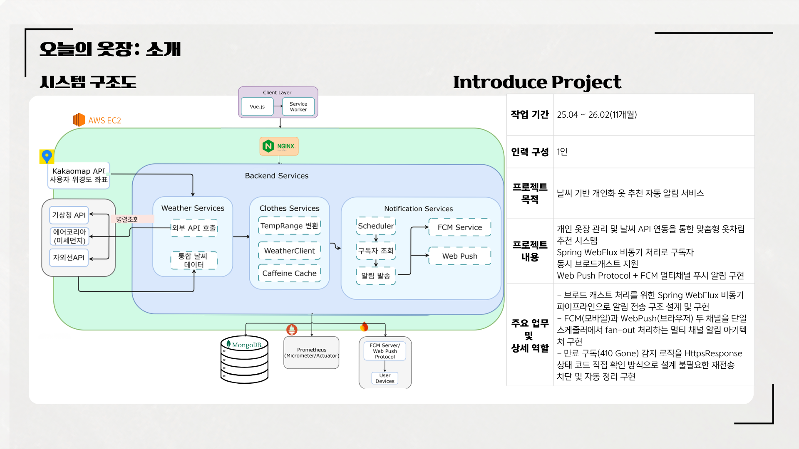

## 오늘의 옷장 (WishWardrobe)

> WebFlux 비동기 처리 기반 푸시 알림 시스템  
> 개인 프로젝트 | 2025.04 – 2026.11.14(현재 운영중)
> https://www.wishward.cloud/

---

## Skills
Java, Spring WebFlux, MongoDB , PostgreSQL , FCM , Web Push API, RabbitMQ, Redis, LightSail , Vercel, Docker, GitHub , Vue.js

---

## 핵심 구현: FCM/WebPush 알림 발송

**알림 종류**
회원 가입시 사용자가 선택 가능
FCM 방식과 WebPush 로 알림 채널을 분기

**쟁점 1: 비정상 토큰 포함 브로드캐스트 시 전체 처리 정지**
현상 : 부하 테스트에서 FCM 비정상 토큰 포함해 브로드캐스트했을 때 응답 없고 처리 요청만 쌓임

원인: FCM 전송이 블로킹 Future.get() 호출이었고 제한된 크기의 boundedElastic 스레드 풀에서 타임아웃 없이 실행됨

응답이 지연된 호출이 스레드 계속 점유하고 Mono.zip이 Webpush와 FCM 두 채널의 완료를 모두 기다리는 구조라 한 채널만 지연돼도 브로드캐스트 전체가 완료되지 않음

영향: 브로드캐스트 전체가 멈추고 처리중인 건수(in-flight)가 계속 증가함

해결: 호출별 timeout(5s) 적용해서 지연된 건은 TimeoutException으로 실패처리되고 나머지 흐름 진행됨

**쟁점 2 : FCM 전송 실패가 success로 집계됨**

현상 : FCM 전송이 실패해도 실패 카운트가 오르지 않고 success로 집계됨

원인 :  FCM 서비스의 onErrorResume이 호출한 Exception이 Mono.empty()를 반환함

onError 시그널이 상위 체인으로 전파되지 않는 에러 삼킴이 발생

에러 신호가 값 없는 정상 완료(onComplete)로 바뀌고 집계 로직은 완료를 성공으로 셈

handleExecutionException의 리턴값을 Mono.error(e)로 변경해 에러 끝까지 전파되도록함

검증: 실패 토큰 100건 전송 시 실패 카운트가 100건으로 집계

---

## 외부 API 연동

**기상청 단기예보 API + 카카오 위치 API**

카카오 API에서 수신한 사용자 현재 위치(위경도)를
기상청 요구 형식인 격자 좌표(nx, ny)로 변환 후 날씨 조회

- 흐름:
카카오 현재위치(위경도) → 격자 좌표 변환 → 기상청 단기예보 API → 날씨 데이터 반환

검증:
서울시청, 강남역, 부산, 인천공항, 제주 5개 지점

위경도 → 격자 좌표 변환 정확도 Postman으로 확인

---

## 암호화

**JWT 토큰을 이용하여 암호화**

JWT 를 이용하여 사용자 위치, 정보를 암호화하도록 하고 해당 토큰에서 userId를 가져와서 

본인이 아니면 사용자 정보에 접근하지 못하도록 함

---

## 옷장 서비스

**오전 7시 날씨별 카테고리로 날씨에 맞는 옷장의 옷이 알림 메시지로 나옴 **

옷 추천 로직은 +/-2단계의 의상 카테고리에서 저장된 

사용자의 옷장에 있는 옷 사진과 의상 설명을 알림 서비스로 보낸다.

오전 7시에 각 사용자별로 옷장에 저장된 "오늘 출근할 때 입을 옷"이 

알림 메시지로 전송된다.

핸드폰의 경우 해당 사이트를 바로가기로 만들고 알림 허용을 하면 아침 7시마다 알림 받을 수 있다.

## 이후 추가될 서비스

** 의상 검색 서비스/ 기본 디폴트 추천 서비스 추가예정 **

